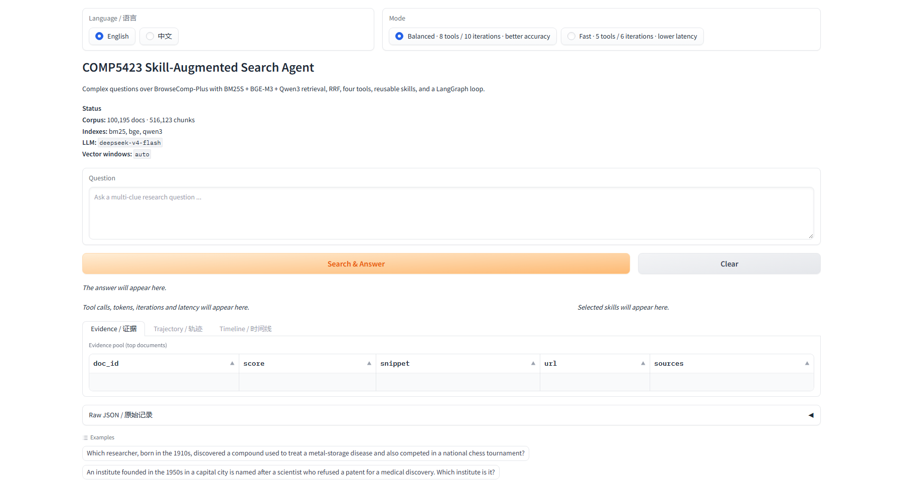
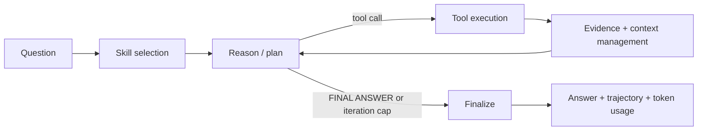

# COMP5423 — Skill-Augmented Search Agent

A lightweight research agent for the **BrowseComp-Plus** fixed corpus. It combines
sparse, dense, and instruction-aware retrieval with a LangGraph tool-using loop,
reusable skills, context management, and a bilingual Gradio UI.

[](https://www.python.org/)
[](https://langchain-ai.github.io/langgraph/)
[](https://www.gradio.app/)
[](LICENSE)



## Highlights

- **Three retrieval categories** exposed through one `unified_retrieval` tool:
  - BM25S over 1200-word chunks (sparse);
  - BGE-M3 document-level dense retrieval with FAISS;
  - Qwen3-Embedding-0.6B document-level dense retrieval with FAISS.
- **RRF fusion** (`k=60`) inside the single retrieval tool, so the agent never
  sees separate retrieval backends.
- **Four tools**: `unified_retrieval`, `document_reader`, `text_searcher`,
  `metadata_filter`.
- **Iterative LangGraph loop** with a 10-iteration cap, an evidence pool (max 5),
  and 4000-token context compression keeping the latest 6 messages.
- **Three runtime skills**: multi-clue decomposition, search recovery, and PDF
  extraction. Only skill names/descriptions are shown during routing; the body
  is loaded lazily.
- **Bilingual Gradio UI** with English / 中文 labels, Fast and Balanced modes,
  evidence, trajectory, per-step latency, a timeline, and raw JSON.
- **Reproducible evaluation**: normalized exact match and token/tool-call
  statistics.

## Results

Validation set (100 questions, reference answers available):

| Metric | Value |
|---|---:|
| Normalized EM | **0.370** (37/100) |
| Average tool calls | **8.42** |
| Average tokens | **50,815** |

Test set (100 questions, no reference answers):

| Metric | Value |
|---|---:|
| Questions completed | **100/100** |
| Total tool calls | **843** |
| Average tool calls | **8.43** |
| Total tokens | **5,669,965** |
| Average tokens | **56,699.65** |

The test set has no public gold answers, so test EM is not computed locally.
The 0.37 validation EM is a stable estimate; a 10-question sample previously
showed 0.6, which was small-sample noise. Error analysis showed that most
remaining errors are wrong-entity retrieval/reasoning errors rather than answer
formatting errors.

## System Architecture



### LangGraph loop

```text
START
  │
skill_select ──► reason ──(tool calls)──► tools ──► compress ──► reason
                   │
                   ├──(FINAL ANSWER / 10 iterations)──► finalize ─► END
                   └──(no action)──────────────────────► reason
```

| Node | Role |
|---|---|
| `skill_select_node` | Routes to 0–2 skills using only names + descriptions. |
| `reason_node` | Builds a compact system prompt and calls the tool-bound LLM. |
| `execute_tools_node` | Runs LangGraph `ToolNode`, records observations and evidence. |
| `compress_context_node` | Compresses old messages when the context exceeds 4000 tokens. |
| `finalize_node` | Extracts `FINAL ANSWER:` or performs one final synthesis call. |

### Retrieval design

| Category | Implementation | Index |
|---|---|---|
| Sparse | BM25S over 1200-word chunks (150-word overlap) | ~516k chunks |
| Encoder dense | BGE-M3 via FlagEmbedding + FAISS | ~151k document vectors |
| Instruction-aware dense | Qwen3-Embedding-0.6B + FAISS | ~151k document vectors |
| Fusion | Reciprocal Rank Fusion, `k=60` | one document ranking |

BM25 keeps chunk-level precision for names/dates/rare phrases. Dense retrieval
scores whole documents (1–2 windows per document), which is much cheaper than
encoding every chunk while still providing semantic recall. `document_reader`
and `text_searcher` provide fine-grained verification.

### Tools

| Tool | Purpose |
|---|---|
| `unified_retrieval` | The only retrieval entry point; BM25 + BGE + Qwen3 fused by RRF. |
| `document_reader` | Opens one document and returns a bounded excerpt; optional PDF extraction. |
| `text_searcher` | Exact phrase / FTS inside one document or across the corpus. |
| `metadata_filter` | Domain/title/URL/date/length filtering. |

### Skills

| Skill | Use |
|---|---|
| `multi-clue-decomposer` | Splits multi-constraint questions into a clue table. |
| `search-recovery` | Recovery ladder when initial searches are weak. |
| `pdf-extractor` | Downloads/parses PDFs and searches inside them. |

Skill bodies live in `code/skills/*/SKILL.md`; the base prompt contains only
names and descriptions.

## GUI


The interface supports:

- **English / 中文** label switching;
- **Balanced** mode (8 tools / 10 iterations) and **Fast** mode
  (5 tools / 6 iterations);
- corpus/index/model status;
- final answer and tool/token/iteration/latency statistics;
- selected skills;
- **Evidence** table (doc_id, score, snippet, URL, retrieval sources);
- **Trajectory** table with per-step LLM and tool latency;
- a rendered **Timeline** of agent steps;
- the complete **Raw JSON** record;
- example questions and a clear button.

A single question requires several sequential LLM calls; Fast mode reduces the
number of API round-trips, while Balanced mode is better for accuracy.

## Quick Start

### 1. Clone

```bash
git clone https://github.com/Swordmynew/5423-group-project.git
cd 5423-group-project/code
```

### 2. Environment

Python 3.10+ is supported; Python 3.12 is recommended.

```bash
python3.12 -m venv .venv
source .venv/bin/activate

# Install the PyTorch build appropriate for your machine first.
pip install torch --index-url https://download.pytorch.org/whl/cu124
pip install -r requirements.txt
```

### 3. Configuration

```bash
cp .env.example .env
```

Edit `.env`:

```dotenv
DEEPSEEK_API_KEY=sk-...
DEEPSEEK_BASE_URL=https://api.deepseek.com/v1
DEEPSEEK_MODEL=deepseek-v4-flash

DATA_DIR=/path/to/data
INDEX_DIR=/path/to/index
MODELS_DIR=/path/to/models
HF_HOME=/path/to/hf_cache
PREDICTION_PATH=/path/to/test_prediction.jsonl
```

Check the environment:

```bash
python3 doctor.py
```

### 4. Build data, indexes, and models

```bash
python3 data/download_data.py
python3 data/preprocess.py
python3 index/build_bm25.py
python3 data/prepare_models.py
python3 index/build_dense.py --backend bge
python3 index/build_dense.py --backend qwen3
```

Generated data, indexes, and model weights are **not** committed. See
[`code/README.md`](code/README.md) for mirrors, retries, OOM handling, and
resume instructions.

### 5. Run

```bash
# Gradio UI
python3 ui/gradio_app.py --server-name 0.0.0.0 --server-port 7860

# Test set
python3 run_test.py \
  --input /path/to/test.jsonl \
  --output ../test_prediction.jsonl \
  --workers 4
```

On a remote server, forward the UI port:

```bash
ssh -p <ssh-port> -L 7860:127.0.0.1:7860 root@<host>
# open http://127.0.0.1:7860
```

## Repository Layout

```text
5423-group-project/
├── README.md                 # project overview (this file)
├── LICENSE
├── docs/
│   └── gui.png               # current Gradio UI screenshot
└── code/
    ├── README.md             # detailed setup and reproduction guide
    ├── requirements.txt
    ├── config.py
    ├── doctor.py
    ├── run_test.py
    ├── evaluate.py
    ├── agent/                # LangGraph state, nodes, graph
    ├── data/                 # download, preprocess, model preparation
    ├── index/                # BM25, dense indexes, RRF retriever
    ├── tools/                # four agent tools
    ├── skills/               # three reusable skills
    └── ui/                   # bilingual Gradio interface
```

## Output Format

`test_prediction.jsonl` contains one JSON object per question:

```json
{
  "id": "<str>",
  "question": "<str>",
  "answer": "<str>",
  "trajectory": [{"iteration": 1, "thought": "...", "tool": "...", "tool_input": {}, "observation": "..."}],
  "tool_calls": 8,
  "total_tokens": 12345
}
```

`tool_calls` counts agent-issued tool calls. `total_tokens` is the sum of API
usage across all LLM calls for that question, including skill routing, reasoning,
compression, and finalization.

## Notes

- The corpus, validation set, and test set are course/BrowseComp-Plus artifacts
  and are not redistributed here.
- No API keys, credentials, model weights, or large indexes are committed.
- See [`code/README.md`](code/README.md) for the full design rationale,
  troubleshooting, and resource requirements.

## License

MIT — see [LICENSE](LICENSE).
